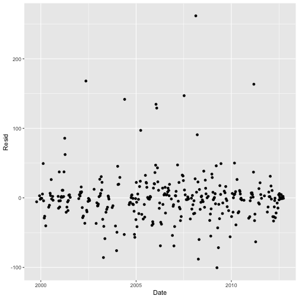
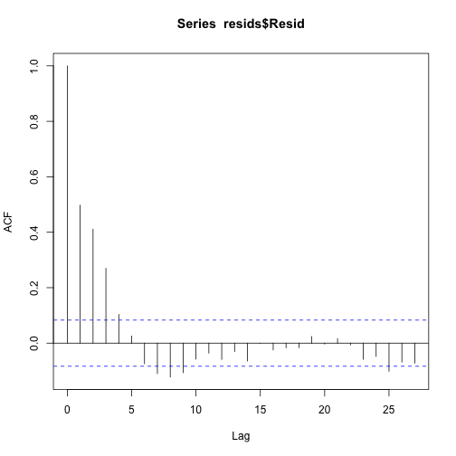

The `loadflex` package lets you quickly fit and compare concentrations and/or
fluxes of solutes in watersheds. This vignette demonstrates the application of
`loadflex` to fit four different model types to the same data, to assess and
compare those models, and to estimate average solute concentrations and fluxes
at both quarter-hourly and monthly scales.

We will use the data supplied with the `loadflex` package. These include nitrate
concentration observations from the Lamprey River in southeastern New Hampshire,
where researchers in the NH Water Resources Research Center (University of New
Hampshire; PI: William H. McDowell) have been monitoring water quality weekly
since 1999. Discharge data are from the same location, Packers Falls, from a
USGS gaging station (https://waterdata.usgs.gov/monitoring-location/USGS-01073500).


Start by loading the package.


``` r
library(loadflex)
```

Load the data provided in this package.


``` r
# Interpolation data: Packers Falls NO3 grab sample observations
data(lamprey_nitrate)
intdat <- lamprey_nitrate[c("DATE","DISCHARGE","NO3")]

# Calibration data: Restrict to points separated by sufficient time
regdat <- subset(lamprey_nitrate, REGR)[c("DATE","DISCHARGE","NO3")]

# Estimation data: Packers Falls discharge
data(lamprey_discharge)
estdat <- subset(lamprey_discharge, DATE < as.POSIXct("2012-10-01 00:00:00", tz="EST5EDT"))
estdat <- estdat[seq(1, nrow(estdat), by=96/4),] # pare to 4 obs/day for speed
```

Create a metadata description of the dataset & desired output.


``` r
meta <- metadata(constituent="NO3", flow="DISCHARGE", 
  dates="DATE", conc.units="mg L^-1", flow.units="cfs", load.units="kg", 
  load.rate.units="kg d^-1", site.name="Lamprey River, NH",
  consti.name="Nitrate", site.id='01073500', lat=43.10259, lon=-70.95256)
```

Fit four models: interpolation, linear, rloadest, and composite. Many variants on these models are possible. For example: `loadInterp` models may use any of several interp.fun options; see `?interpolations`. `loadLm` accepts any linear model acceptable to `lm()`, not just the very simple formula we have used here. `loadReg2` functions are also flexible as specified in the documentation for \pkg{rloadest}. `loadComp` models accept a linear model as fit by either `loadLm` or `loadReg2` and any of the interp.fun options available to `loadInterp`.


``` r
no3_li <- loadInterp(interp.format = "conc", interp.fun = rectangularInterpolation, 
  data = intdat, metadata = meta)
no3_lm <- loadLm(formula = log(NO3) ~ log(DISCHARGE), pred.format = "conc", 
  data = regdat, metadata = meta, retrans = exp)
library(rloadest)
no3_lr <- loadReg2(loadReg(NO3 ~ model(9), data = regdat,
  flow = "DISCHARGE", dates = "DATE", time.step = "instantaneous", 
  flow.units = "cfs", conc.units = "mg/L", load.units = "kg",
  station='Lamprey River, NH'))
no3_lc <- loadComp(reg.model = no3_lr, interp.format = "conc", 
  interp.data = intdat, store = c("data", "fitting.function", "uncertainty"))
```

You can inspect these models in a variety of model-specific ways. Here are some commands to try:


``` r
getMetadata(no3_li)
```

```
## Metadata for a load model
## -NAME-       -VALUE-
## constituent  NO3
## consti.name  Nitrate
## flow         DISCHARGE
## load.rate    
## dates        DATE
## conc.units   mg L^-1
## flow.units   ft^3 s^-1
## load.units   kg
## load.rate.units kg d^-1
## station      
## site.name    Lamprey River, NH
## site.id      01073500
## lat          43.10259
## lon          -70.95256
## basin.area   NA
## flow.site.name 
## flow.site.id 
## flow.lat     NA
## flow.lon     NA
## flow.basin.area NA
## basin.area.units km^2
```

``` r
get('formula', environment(getFittingFunction(no3_lm)))
```

```
## log(NO3) ~ log(DISCHARGE)
```

``` r
getFittedModel(no3_lr)
```

```
## *** Load Estimation ***
## 
## Station: Lamprey River, NH
## Constituent: NO3
## 
##            Number of Observations: 318
## Number of Uncensored Observations: 318
##            Center of Decimal Time: 2006.382
##                   Center of ln(Q): 4.9433
##                  Period of record: 1999-10-12 17:10:00 to 2012-09-25 10:34:59
## 
## Selected Load Model:
## --------------------
## 
## NO3 ~ model(9)
## 
## Model coefficients:
##              Estimate Std. Error  z-score p-value
## (Intercept)  4.119184   0.027599 149.2493  0.0000
## lnQ          0.803626   0.018832  42.6744  0.0000
## lnQ2        -0.039398   0.010044  -3.9224  0.0001
## DECTIME      0.002079   0.004472   0.4648  0.6384
## DECTIME2    -0.008695   0.001312  -6.6282  0.0000
## sin.DECTIME  0.263894   0.029630   8.9064  0.0000
## cos.DECTIME  0.198111   0.023759   8.3382  0.0000
## 
## AMLE Regression Statistics
## Residual variance: 0.08273
## R-squared: 93.28 percent
## G-squared: 858.8 on 6 degrees of freedom
## P-value: <0.0001
## Prob. Plot Corr. Coeff. (PPCC):
##   r = 0.9914
##   p-value = 0.0012
## Serial Correlation of Residuals: 0.3061
## 
## Variance Inflation Factors:
##               VIF
## lnQ         1.651
## lnQ2        1.031
## DECTIME     1.022
## DECTIME2    1.078
## sin.DECTIME 1.431
## cos.DECTIME 1.206
## 
## Comparison of Observed and Estimated Loads
## ------------------------------------------
##       Summary Stats: Loads in kg/d
## ---------------------------------------------
##      Min  25%  50% 75% 90% 95% Max
## Est 2.76 37.2 78.3 148 230 291 551
## Obs 1.77 36.7 77.1 135 242 314 651
## 
## Bias Diagnostics
## ----------------
##  Bp: -0.1701 percent
## PLR: 0.9983
##   E: 0.8856
```

``` r
head(getFittingData(no3_lc))
```

```
##                   DATE DISCHARGE    NO3
## 24 1999-10-05 18:00:00   84.0000 0.0913
## 25 1999-10-12 17:10:00   83.0000 0.0826
## 33 1999-12-07 15:20:00  363.6667 0.1138
## 34 1999-12-14 14:30:00  271.0000 0.0858
## 35 1999-12-21 13:45:00  318.0000 0.1213
## 36 1999-12-28 09:04:59  232.5670 0.1201
```


``` r
ggplot2::qplot(x=Date, y=Resid, data=getResiduals(no3_lr, newdata=regdat))
```




``` r
estimateRho(no3_lr, "conc", newdata=intdat, irreg=TRUE)$rho
```



```
## [1] 0.4978788
```


``` r
summary(getFittedModel(no3_lm))
```

```
## 
## Call:
## lm(formula = formula, data = data)
## 
## Residuals:
##      Min       1Q   Median       3Q      Max 
## -0.77044 -0.30404  0.00749  0.27882  1.28997 
## 
## Coefficients:
##                Estimate Std. Error t value Pr(>|t|)    
## (Intercept)    -1.59404    0.09640 -16.536   <2e-16 ***
## log(DISCHARGE) -0.05641    0.01819  -3.101   0.0021 ** 
## ---
## Signif. codes:  0 '***' 0.001 '**' 0.01 '*' 0.05 '.' 0.1 ' ' 1
## 
## Residual standard error: 0.3569 on 316 degrees of freedom
## Multiple R-squared:  0.02953,	Adjusted R-squared:  0.02646 
## F-statistic: 9.617 on 1 and 316 DF,  p-value: 0.002102
```

``` r
residDurbinWatson(no3_lr, "conc", newdata=regdat, irreg=TRUE, plot.acf = FALSE)
```

```
## [1] 1.319662
```

``` r
getCorrectionFraction(no3_lc, "flux", newdat=intdat)
```

```
## [1] 0.2187752
```


Now generate point predictions from each model.


``` r
preds_li <- predictSolute(no3_li, "flux", estdat, se.pred=TRUE)
preds_lm <- predictSolute(no3_lm, "flux", estdat, se.pred=TRUE, lin.or.log="linear")
preds_lr <- predictSolute(no3_lr, "flux", estdat, se.pred=TRUE)
preds_lc <- predictSolute(no3_lc, "flux", estdat, se.pred=TRUE)
```

A few lines from one of the resulting prediction data.frames:


``` r
head(preds_lr)
```

```
##                  date     flux  se.pred
## 1 1999-10-01 01:00:00 15.72780 4.722913
## 2 1999-10-01 07:00:00 16.68311 5.010515
## 3 1999-10-01 13:00:00 17.39594 5.225214
## 4 1999-10-01 19:00:00 16.94764 5.090053
## 5 1999-10-02 01:00:00 16.72981 5.024355
## 6 1999-10-02 07:00:00 16.51078 4.958313
```

The `loadflex` process for aggregation of point predictions (to monthly, annual, etc.)
has changed since we published our 2015 manuscript.
`aggregateSolute` from that manuscript is no longer exported as a function in loadflex.
Instead, you can use the `agg.by` argument to `predictSolute` to
generate predictions at the time interval of interest.

You can aggregate for for months, water years, calendar years, or other time intervals,
and for mean concentration (named `conc` in the output)
or flux (`flux.rate` in the output, using "rate" to remind users that the time denominator
does not change regardless of the time period being aggregated over).

Standard errors (`se.fit` and `se.pred`) are available for `loadReg2` flux models (but see
https://github.com/USGS-R/rloadest/issues/30 and https://github.com/DOI-USGS/loadflex/issues/262).
`loadReg2` conc models also support aggregation, but only to `day`.

The units of the aggregated output are what you passed into each model as metadata.
`count` reports the number of observations going into the aggregated estimate in each row.
Some examples:


``` r
getUnits(getMetadata(no3_lr), 'conc')
```

```
## [1] "mg L^-1"
```

``` r
agg_c_li <- predictSolute(no3_li, "conc", newdata = estdat, agg.by = "water year")
agg_c_lm <- predictSolute(no3_lm, "conc", newdata = estdat, agg.by = "calendar year")
agg_c_lr <- predictSolute(no3_lr, "conc", newdata = estdat, agg.by = "day", se.fit = TRUE, se.pred = TRUE)
agg_c_lc <- predictSolute(no3_lc, "conc", newdata = estdat, agg.by = "month")

getUnits(getMetadata(no3_lr), 'flux rate')
```

```
## [1] "kg d^-1"
```

``` r
agg_f_li <- predictSolute(no3_li, "flux", newdata = estdat, agg.by = "day")
agg_f_lm <- predictSolute(no3_lm, "flux", newdata = estdat, agg.by = "water year")
agg_f_lr <- predictSolute(no3_lr, "flux", newdata = estdat, agg.by = "month", se.fit = TRUE, se.pred = TRUE)
agg_f_lc <- predictSolute(no3_lc, "flux", newdata = estdat, agg.by = "total")
```

A few lines from some of the resulting aggregated flux data.frames:


``` r
agg_c_li
```

```
##    water.year      conc count
## 1        2000 0.1165354  1464
## 2        2001 0.1467814  1460
## 3        2002 0.1783221  1460
## 4        2003 0.1463932  1460
## 5        2004 0.1672477  1464
## 6        2005 0.1613692  1460
## 7        2006 0.1683125  1460
## 8        2007 0.1864791  1460
## 9        2008 0.1552109  1464
## 10       2009 0.1458179  1460
## 11       2010 0.1302498  1460
## 12       2011 0.1367034  1460
## 13       2012 0.1297170  1464
```

``` r
head(agg_c_lm)
```

```
##   calendar.year      conc count
## 1          1999 0.1603043   368
## 2          2000 0.1623410  1464
## 3          2001 0.1700511  1460
## 4          2002 0.1713046  1460
## 5          2003 0.1622097  1460
## 6          2004 0.1619884  1464
```

``` r
head(agg_f_lr)
```

```
##     month count.days flux.rate    se.fit   se.pred
## 1 1999-10         31  40.94773  2.739797  2.590990
## 2 1999-11         30  63.30012  3.966930  3.602738
## 3 1999-12         31  83.90806  4.765753  4.629322
## 4 2000-01         31  93.50012  4.818706  5.327664
## 5 2000-02         29  96.52117  4.720724  6.159949
## 6 2000-03         31 218.47354 12.663481 12.175463
```

``` r
agg_f_lc
```

```
##   total flux.rate count
## 1     1  103.2865 18996
```
